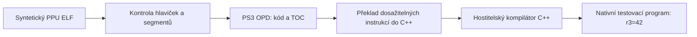

# Architektura a vývoj AnyPS3

## Cíl a ověřený stav

Cílem je převod kódu PS3 na nativní programy PC s kompatibilními systémovými
službami. První integrační cíl je Ratchet & Clank: A Crack in Time.
Předběžná cílová platforma je Linux x86-64; uživatel zatím platformu nepotvrdil.
K datu 2026-10-14 je analyzovaný EBOOT vydání BCES00511 01.00, získaný
z nyní kompletního ISO s ověřenou CRC. Máme mapu importů, první nativně spuštěné
jednoduché funkce, paměťový runtime a částečně vykonaný staticky přeložený start procesu.
Hra jako celek zatím nenaběhne. Viz
[výsledky a omezení](ratchet-acit-startup.md).

Základní ověřovací průchod je:

Instrukce se překládají před spuštěním. Výsledný program neobsahuje smyčku
dekódující původní instrukce. Registry jsou však stále explicitním stavem PPU;
takový výstup není rekonstrukcí původního zdrojového kódu hry.

## Rozšířený start procesu

`program.py` staví statický graf včetně podmíněných větví a volání. `flow.py`
převádí každou instrukci do C++; přepínač adres za běhu vybírá již přeložený
blok. `startup.py` připravuje ABI vstupu a TLS, `services.py` implementuje
vyjmenované systémové služby a `floating.py` přesné celočíselné FP výpočty
pro podporované normální hodnoty a zaokrouhlování. Neexistuje interpreter
ani překlad nových instrukcí za běhu. Diagnostický režim končí na neznámém
bloku, instrukci nebo službě. Explicitní statické cíle v profilu pouze
rozšiřují překládaný graf; nenahrazují skutečné rozhodování původního programu.

`mmapper.py` spravuje rezervace virtuálních adres a sdílené fyzické uložení.
`kernel_sync.py` a `events.py` poskytují stavové mutexy, podmínky, semafory
a FIFO fronty. `threads.py` přepíná skutečné PPU kontexty, včetně samostatných
registrů a TLS; čekání bez timeoutu u podporovaných objektů uvolňuje procesor.
Exit vedlejšího vlákna uvolňuje jeho zásobník a TLS; join čeká na skutečný
exit a převezme 64bitový návratový stav. Plánování při inicializaci modulů
a zbývající operace životního cyklu vláken zatím chybí.

`sysutil_transport.py` obsluhuje `CMND connect`, dotaz na konfiguraci
videovýstupu, jeho změnu na 720p, jazyk a potvrzovací tlačítko a `GDAT` metadata startu.
`native_fs.py` čte skutečný PARAM.SFO z explicitně připojeného adresáře disku.
Odpovědi jsou serializované do sdílených kruhových bufferů a původní firmware
je skutečně parsuje. GDAT navíc podporuje relaci a dotaz na nové herní
úložiště pod `ANYPS3_HDD_ROOT`, účtuje pracovní paměť kontejneru a vrací
skutečné volné místo hostitele. Existující uložená metadata a další rodiny
požadavků explicitně selhávají. Konfigurace
videovýstupu sama nevytváří framebuffer ani renderer.

`spu.py` staticky překládá vybranou celočíselnou ISA SPU, kanály a DMA do C++.
`spu_runtime.py` importuje metadata obrazu a vytváří skupiny, vlákna a jejich
256KiB lokální paměť. Bootstrap i blok později načtený DMA mají předem
přeložené operace; kontrola původních slov odmítne změněný kód. Atomické DMA
sleduje rezervace sdílené paměti včetně zápisů přes alias. SPU běží
v kooperativních kvantech společně s PPU; čekání na ztrátu rezervace jej
uspí a skutečný zápis paměti probudí. Mailbox podporuje odeslání skutečné
události do připojené PPU fronty, odpověď a opakování při plné frontě.
DMA může překročit sousední mapování; celý rozsah se ověří před kopírováním.
Další události a úplný životní cyklus vláken chybí.
Pět herních pracovních SPU nyní vykonává i původní správce úloh
z EBOOT, načítaný DMA. Překrývající se overlaye se překládají předem;
dvojice adresy a přesného původního slova vybírá známou přeloženou variantu.
Neznámé slovo nadále končí chybou. SNR podporuje skutečná oznámení z PPU,
režim přepsání/OR a blokující čtení. Skupina typu `0x18` rezervuje fyzické
SPU bez účtování neexistujícího kontextu do hlavní paměti.
Statické cíle firmwaru i obrazy SPU v profilu vyžadují shodu SHA-256.

`native_pad.py` poskytuje omezené rozhraní `cellPad` přes skutečné SDL2.
Zařízení, tlačítka, analogové osy, připojení a odpojení pocházejí od hostitele;
bez připojeného ovladače hlásí nula zařízení. Pohyb a vibrace nejsou podporované.

`native_fs.py` připojuje také systémovou cache k explicitně zadanému
`ANYPS3_CACHE_ROOT`. První připojení vytvoří soukromý hostitelský adresář,
opakované připojení stejného ID zachová data a vymazání skutečně odstraní
obsah. Cache mezi procesy zatím nepřetrvává. Veřejné API `cellSysCacheMount`
a `cellSysCacheClear` používá tuto nativní službu; interní VSH `cacheInit`
se tím neoznačuje za implementovaný. Paměťové kontejnery v `mmapper.py`
rezervují rozpočet, vykazují dostupnou paměť a vracejí ji po zrušení.

Souborové LV2 služby mapují mounty na explicitní kořeny a vlastní oddělené
guest deskriptory. Open/read/write/seek/stat používají skutečné hostitelské
soubory; disk je jen pro čtení. Hodnoty velikostí a volného místa pocházejí
z hostitele, sektor a blok z konfigurace PS3 mountu. Symlinky a průchod
`..` se odmítají. Neznámé operace se nezaměňují za úspěch.

`lightweight_sync.py` zajišťuje čekání a probouzení lehkých podmínkových
proměnných. Čekání uvolní mutex a po signálu musí znovu získat vlastnictví
včetně původní rekurze. Původní FIOS plánovač a pracovní vlákna používají
tento mechanismus; časově omezená čekání zatím nejsou implementována.

`rsx.py` mapuje VRAM, sdílené I/O, DMA řídicí oblast a zprávy zařízení.
Čte skutečný FIFO proud s GET/PUT, větvením, semafory a referencemi. Ukládá
vyjmenované konfigurační registry, popisy displejových bufferů, dlaždic a Z-cull.
Původní GCM firmware provádí svou inicializaci. `vulkan.py` poskytuje volitelný
Vulkan backend pro úplné barevné ARGB8 a bitově přesné Z24S8 čištění
v lokální VRAM. `rsx_surface.py` řeší dlaždicové adresování a dva vzorky
při čištění. Používá skutečný render pass a readback s kontrolou pixelů;
stejnou cestu lze vykonat na CPU přes Lavapipe. Vlastní softwarový renderer
nevzniká. [Ověření a reprodukce](vulkan-rendering.md).
Neznámý příkaz, kreslení geometrie, neprázdný blit a nepodporovaný druh čištění
zastaví běh. Shadery, dekódování komprimovaných dat a prezentace do okna
zatím chybí. `rsx_display.py` poskytuje headless flip do skutečného PPM
snímku; při neúspěchu výstupu se flip nepotvrdí. GPU reporty uchovávají
hodnoty a monotónní časové značky;
prázdné čítače odpovídají dosavadnímu běhu bez geometrie. Fronta display
bufferů oznamuje připravenost původnímu firmwaru. Vblank vychází ze
skutečného monotónního času při 60000/1001 Hz a není potvrzením prezentace.

`vector.py` překládá další VMX operace s endianitou vektorů, aliasy registrů,
CR6 a VSCR. Podporovaná FP aritmetika používá celočíselné zaokrouhlování
bez změny skalárního FPSCR; `floating.py` provádí sloučené násobení a sčítání
s jediným zaokrouhlením. `vrefp` nyní počítá přesně zaokrouhlenou reciprokou
hodnotu, takže poslední bity nemusí odpovídat odhadové tabulce Cell.
Nejde o ověření bitové shody všech matematických rutin s PS3. Nepodporované
podnormální výsledky, přetečení a režim VMX non-Java stále zastavují běh.

Následující původní podmnožina popisuje jednoduchý příkaz `recompile`.

## Rozdělení kódu

| Soubor | Odpovědnost |
|---|---|
| `anyps3/elf.py` | Hlavičky, segmenty, virtuální čtení, vstupní deskriptor, report |
| `anyps3/archive.py`, `anyps3/disc.py` | Obnova ISO, inventář, extrakce a evidence neúplných dat |
| `anyps3/sfo.py`, `anyps3/self_file.py` | Identita hry a ověřená rekonstrukce load segmentů SELF |
| `anyps3/analysis.py` | Sekce, OPD, importy, SPU a první překážky překladu |
| `anyps3/ppu.py` | Dekódování podmnožiny instrukcí, dosažitelnost, generování C++ |
| `anyps3/runtime.py` | Generovaný C++ runtime: segmenty, BSS, zásobník, endianita a kontrola přístupů |
| `anyps3/demo.py` | Reprodukovatelný původní testovací ELF |
| `anyps3/profile.py` | Ověření identity vstupu podle explicitního SHA-256 |
| `anyps3/cli.py` | CLI a zápis nových výstupů |
| `tests/test_anyps3.py` | Negativní testy parseru a skutečné sestavení/spuštění výstupu |

Inspekce a překlad používají pouze standardní knihovnu Pythonu. Volitelná
extrakce SELF potřebuje `cryptography` a explicitní soubor klíče.
První překlad do C++ umožňuje
ověřovat chování bez instalace LLVM SDK. Po rozšíření backendu lze rozhodnout,
zda zůstat u C++ nebo přejít na LLVM IR; nynější kód nás k backendu neváže.

## Pravidla správnosti

- Virtuální adresy se převádějí přes `PT_LOAD`, nikdy nepoužívají přímo jako
  offset v souboru. Velikost segmentu v paměti není velikost jeho dat v souboru.
- Inspekce nemapuje guest paměť a nealokuje velikosti deklarované v `p_memsz`.
  Samotný vstupní soubor se zatím čte celý do paměti.
- Kód se smí číst pouze z jednoznačně mapovaného, souborově podloženého
  spustitelného segmentu. BSS se nesmí pokládat za nuly obsahující instrukce.
- PPU vstupní deskriptor je interpretován explicitně jako dvě 32bitová slova.
  Nesnažíme se heuristicky zaměňovat jeho adresu s adresou instrukce.
- Celočíselná aritmetika používá 64bitové bezznaménkové hodnoty pro definované
  přetečení. Znaménkové immediate se rozšíří před převodem na tuto hodnotu.
- Nepodporovaná dosažitelná instrukce či nepodporovaný vedlejší efekt zastaví
  překlad. Není dovoleno nahrazovat neznámé chování prázdným tělem či úspěchem.
- V této podmnožině má instrukce nejvýše jednoho následníka. Překladač sleduje
  skoky, zastaví cykly při analýze a vyžaduje dosažitelný návrat. Nenachází ani
  neslibuje hranice všech funkcí v binárce.
- Vygenerování zdroje proběhne až po úspěšné analýze celého dosažitelného kódu.
  Zápis používá výhradní vytvoření souboru; vstup ani staré výstupy se nepřepisují.
- Shoda hashů potvrzuje pouze identitu konkrétní binárky, nikoli její hratelnost.

## Další milníky

### 1. Paměť a řízení toku — bez dumpu

Guest paměť s big-endian přístupy, kontrolou mapování, syntetickým zásobníkem
a základními D/DS-form load/store už funguje. V `recompile-program` jsou nyní také CR, porovnání,
podmíněné skoky, LR/CTR a volání/vracení.
Podporu zavádět po instrukcích s ověřením pozorovatelných výsledků.
Akceptace: původní testovací ELF s cyklem, voláním a prací s pamětí vrátí
správný výsledek; nepodporované formy nadále selžou s adresou.

### 2. Ověření existujícího backendu — bez dumpu

Stáhnout a připnout konkrétní revizi ps3recomp, zreprodukovat jeho build
a testy na našem systému. Porovnat správnost překladače na společných
syntetických vektorech, zejména atomiky, endianitu, VMX a floating point.
Teprve poté rozhodnout o adaptéru či převzetí vybraných částí a jejich licencích.
Současný malý překladač je ověřovací základ, nikoli závazek znovu napsat celý
existující projekt. Síťový přístup ze shellu k GitHubu selhal na DNS; ps3recomp zatím není
stažený ani sestavený. Uživatel mezitím dodal referenční zdrojáky RPCS3 do
`local/reference/rpcs3` (revize `ffba2bf09ef3980638f9327b25240d81414034ab`).
RPCS3 slouží k lokálnímu čtení ABI a ISA, jeho backend se nepoužívá.

### 3. Importy a systémové služby

Inspekce sekcí a importů/NID už funguje na skutečném EBOOT. Offline relokace vybraných PRX a vazba jejich exportů už funguje
v diagnostickém společném obrazu. Doplnit obecný životní cyklus modulů
a další systémová volání. Zavést registr skutečně
implementovaných služeb a diagnostiku chybějící knihovny, NID a adresy volání.
Akceptace: syntetický program zavolá implementovanou službu; neznámý import
skončí konkrétní chybou. Úspěšný stub není implementace služby.

### 4. SPU — bez dumpu

Identifikace SPU ELF, statický bootstrap, lokální paměť, vybrané kanály,
DMA a atomické rezervace již mají nativní testy a první průchod ve firmwaru.
Doplnit další události, mailboxy a úplný životní cyklus vláken.
Paměťová kopie samotná nezajišťuje pořadí ani dokončení DMA.
Akceptace: PPU předá data SPU úloze a správně převezme výsledek.

### 5. RSX — bez dumpu

Testovat malé proudy grafických příkazů a původní jednoduché shadery.
Akceptace: známý framebuffer nebo trojúhelník přes Vulkan, s kontrolou
výsledného obrazu. Otevřené okno ani úspěšná kompilace shaderu nestačí.
První část splňuje diagnostický framebuffer s RSX clear příkazy a kontrolou
všech pixelů přes Lavapipe; trojúhelníky a RSX shadery zbývají.

### 6. Integrace Ratcheta — probíhá

Vydání, verze, hashe, importy, vložené SPU a první překážka překladu jsou
zaznamenány. Start procesu už prochází voláními, TLS a konstruktory. Přesnou aktuální
překážku zaznamenává [zpráva o nativním startu](ratchet-acit-startup.md).
Podle skutečného běhu
postupovat přes první obraz, menu a ovladatelnou scénu ke zvuku a ukládání.
Každý milník musí být reprodukovatelný pro daný hash vstupu.
Výkon porovnávat až při shodném chování; statická rekompilace sama
nezaručuje zrychlení proti RPCS3.

## Technické zdroje

Odkazy byly použity pro návrh a ověření formátů, ne pro kopírování implementace.

- [ELF header, System V ABI](https://refspecs.linuxfoundation.org/elf/gabi4+/ch4.eheader.html)
  a [program headers](https://refspecs.linuxfoundation.org/elf/gabi4+/ch5.pheader.html):
  rozložení hlaviček, segmentů a jejich význam.
- [RPCS3 PPUOpcodes.h](https://github.com/RPCS3/rpcs3/blob/master/rpcs3/Emu/Cell/PPUOpcodes.h):
  pole instrukcí a opkódy PPU. Lokální LLVM assembler sloužil k nezávislé
  kontrole binárních testovacích vektorů.
- [RPCS3 PPUInterpreter.cpp](https://github.com/RPCS3/rpcs3/blob/master/rpcs3/Emu/Cell/PPUInterpreter.cpp):
  kontrola DS displacementu a pořadí paměťové operace a změny registru v update formách.
- [ps3recomp ppu_loader.py](https://github.com/sp00nznet/ps3recomp/blob/master/tools/ppu_loader.py):
  PS3 deskriptor `{u32 code, u32 toc}` a význam vstupní adresy.
- [AnyPS5 architecture](https://github.com/boykopovar/AnyPS5/blob/main/docs/dev/ARCHITECTURE.md):
  inspirace oddělením převodu binárky od implementace systémových knihoven.
- [ps3recomp](https://github.com/sp00nznet/ps3recomp): kandidát na rozsáhlejší
  rekompilační a runtime backend. Jeho stav pro naši hru dosud není ověřený.

Dokumentace upstream projektů může za kódem zaostávat. Převzetí backendu
musí vycházet z konkrétní revize, opakovatelného sestavení a testů.
