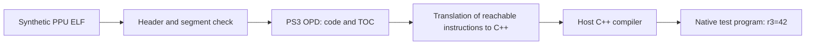

# Architecture and development of AnyPS3

## Goal and verified state

The goal is to convert PS3 code into native PC programs with compatible system
services. The first integration target is Ratchet & Clank: A Crack in Time.
The tentative target platform is Linux x86-64; the user has not yet confirmed the platform.
As of 2026-10-14, the analyzed EBOOT is of release BCES00511 01.00, obtained
from the now complete ISO with a verified CRC. We have an import map, the first natively executed
simple functions, a memory runtime and a partially executed statically translated process start.
The game as a whole does not start yet. See
[results and limitations](ratchet-acit-startup.md).

The basic verification pass is:

Instructions are translated before execution. The resulting program contains no loop
that decodes the original instructions. The registers are, however, still an explicit PPU state;
such output is not a reconstruction of the game's original source code.

## Extended process start

`program.py` builds a static graph including conditional branches and calls. `flow.py`
converts each instruction to C++; an address switch selects the already translated
block at run time. `startup.py` prepares the entry ABI and TLS, `services.py` implements
the enumerated system services and `floating.py` exact integer FP computations
for supported normal values and rounding. There is no interpreter
and no translation of new instructions at run time. The diagnostic mode ends at an unknown
block, instruction or service. Explicit static targets in the profile only
extend the translated graph; they do not replace the actual decision-making of the original program.

`mmapper.py` manages virtual address reservations and shared physical storage.
`kernel_sync.py` and `events.py` provide stateful mutexes, conditions, semaphores
and FIFO queues. `threads.py` switches real PPU contexts, including separate
registers and TLS; waits without a timeout on supported objects release the processor.
The exit of a secondary thread releases its stack and TLS; join waits for the actual
exit and takes over the 64-bit return state. Scheduling during module initialization
and the remaining thread lifecycle operations are still missing.

`sysutil_transport.py` handles `CMND connect`, the query for the video output
configuration, its change to 720p, the language and the confirmation button, and the `GDAT` start metadata.
`native_fs.py` reads a real PARAM.SFO from an explicitly attached disc directory.
Responses are serialized into shared ring buffers and the original firmware
actually parses them. In addition, GDAT supports a session and a query for a new game
storage under `ANYPS3_HDD_ROOT`, accounts the container's working memory and returns the
actual free space of the host. Existing stored metadata and other request families
fail explicitly. The video output configuration
by itself creates neither a framebuffer nor a renderer.

`spu.py` statically translates the selected integer SPU ISA, channels and DMA to C++.
`spu_runtime.py` imports image metadata and creates groups, threads and their
256 KiB local memory. Both the bootstrap and a block loaded later by DMA have pre-translated
operations; a check of the original words rejects changed code. Atomic DMA
tracks reservations of shared memory, including writes through an alias. The SPU runs
in cooperative quanta together with the PPU; waiting for the loss of a reservation puts it
to sleep and an actual memory write wakes it. The mailbox supports sending a real
event to an attached PPU queue, a response and a retry when the queue is full.
DMA may cross adjacent mappings; the entire range is verified before copying.
Further events and the complete thread lifecycle are missing.
The five game worker SPUs now also run the original task manager
from the EBOOT, loaded by DMA. Overlapping overlays are pre-translated;
the pair of address and exact original word selects a known translated variant.
An unknown word still ends with an error. SNR supports real notifications from the PPU,
overwrite/OR mode and blocking reads. A group of type `0x18` reserves a physical
SPU without accounting a nonexistent context into main memory.
Static firmware targets and SPU images in the profile require a SHA-256 match.

`native_pad.py` provides a limited `cellPad` interface over real SDL2.
Devices, buttons, analog axes, connection and disconnection originate from the host;
with no controller connected it reports zero devices. Motion and vibration are not supported.

`native_fs.py` also attaches the system cache to the explicitly specified
`ANYPS3_CACHE_ROOT`. The first attach creates a private host directory,
repeated attach of the same ID keeps the data and clearing actually removes
the content. The cache does not yet persist between processes. The public API `cellSysCacheMount`
and `cellSysCacheClear` uses this native service; the internal VSH `cacheInit`
is not thereby considered implemented. Memory containers in `mmapper.py`
reserve a budget, report available memory and return it after cancellation.

The LV2 file services map mounts to explicit roots and own separate
guest descriptors. Open/read/write/seek/stat use real host
files; the disc is read-only. Size and free-space values come
from the host, sector and block from the PS3 mount configuration. Symlinks and `..`
traversal are rejected. Unknown operations are not mistaken for success.

`lightweight_sync.py` provides waiting and waking of lightweight condition
variables. A wait releases the mutex and after the signal must reacquire ownership,
including the original recursion. The original FIOS scheduler and worker threads use
this mechanism; timed waits are not yet implemented.

`rsx.py` maps VRAM, shared I/O, the DMA control area and device messages.
It reads the actual FIFO stream with GET/PUT, branching, semaphores and references. It stores
the enumerated configuration registers and descriptions of display buffers, tiles and Z-cull.
The original GCM firmware performs its initialization. `vulkan.py` provides an optional
Vulkan backend for full-colour ARGB8 and bit-exact Z24S8 clears
in local VRAM. `rsx_surface.py` handles tiled addressing and two samples
during clears. It uses a real render pass and a readback with pixel verification;
the same path can be executed on the CPU through Lavapipe. No custom software renderer
is being created. [Verification and reproduction](vulkan-rendering.md).
An unknown command, geometry drawing, a non-empty blit and an unsupported kind of clear
stop the run. Shaders, decoding of compressed data and presentation to the window
are still missing. `rsx_display.py` provides a headless flip into a real PPM
frame; if the output fails, the flip is not confirmed. GPU reports retain
values and monotonic timestamps;
empty counters correspond to the run so far without geometry. The display
buffer queue reports readiness to the original firmware. Vblank is derived from
real monotonic time at 60000/1001 Hz and is not a confirmation of presentation.

`vector.py` translates further VMX operations with vector endianness, register aliases,
CR6 and VSCR. Supported FP arithmetic uses integer rounding
without changing the scalar FPSCR; `floating.py` performs fused multiply-add
with a single rounding. `vrefp` now computes an exactly rounded reciprocal,
so the last bits may not match the Cell estimate table.
This is not verification of bit-exactness of all math routines with the PS3. Unsupported
subnormal results, overflow and the VMX non-Java mode still stop the run.

The following original subset describes the simple `recompile` command.

## Code layout

| File | Responsibility |
|---|---|
| `anyps3/elf.py` | Headers, segments, virtual reads, entry descriptor, report |
| `anyps3/archive.py`, `anyps3/disc.py` | ISO recovery, inventory, extraction and records of incomplete data |
| `anyps3/sfo.py`, `anyps3/self_file.py` | Game identity and verified reconstruction of SELF load segments |
| `anyps3/analysis.py` | Sections, OPD, imports, SPU and the first translation blockers |
| `anyps3/ppu.py` | Decoding of an instruction subset, reachability, C++ generation |
| `anyps3/runtime.py` | Generated C++ runtime: segments, BSS, stack, endianness and access checks |
| `anyps3/demo.py` | Reproducible original test ELF |
| `anyps3/profile.py` | Verification of input identity by an explicit SHA-256 |
| `anyps3/cli.py` | CLI and writing of new outputs |
| `tests/test_anyps3.py` | Negative parser tests and real build/run of the output |

Inspection and translation use only the Python standard library. Optional
SELF extraction needs `cryptography` and an explicit key file.
The first translation to C++ makes it possible
to verify behaviour without installing the LLVM SDK. After the backend is extended, we can decide
whether to stay with C++ or move to LLVM IR; the current code does not tie us to a backend.

## Correctness rules

- Virtual addresses are converted through `PT_LOAD`, never used directly as
  a file offset. The size of a segment in memory is not the size of its data in the file.
- Inspection does not map guest memory and does not allocate the sizes declared in `p_memsz`.
  The input file itself is still read into memory in full.
- Code may be read only from an unambiguously mapped, file-backed
  executable segment. BSS must not be taken as zeros containing instructions.
- The PPU entry descriptor is interpreted explicitly as two 32-bit words.
  We do not try to heuristically confuse its address with the address of an instruction.
- Integer arithmetic uses 64-bit unsigned values for defined
  overflow. Signed immediates are extended before conversion to this value.
- An unsupported reachable instruction or an unsupported side effect stops
  the translation. Replacing unknown behaviour with an empty body or with success is not allowed.
- In this subset an instruction has at most one successor. The translator follows
  jumps, stops cycles during analysis and requires a reachable return. It neither finds nor
  promises the boundaries of all functions in the binary.
- Source generation happens only after a successful analysis of the entire reachable code.
  Writing uses exclusive file creation; neither the input nor old outputs are overwritten.
- A hash match confirms only the identity of the specific binary, not its playability.

## Next milestones

### 1. Memory and control flow — without a dump

Guest memory with big-endian accesses, mapping checks, a synthetic stack
and basic D/DS-form load/store already works. `recompile-program` now also has CR, comparisons,
conditional jumps, LR/CTR and call/return.
Introduce support instruction by instruction, with verification of observable results.
Acceptance: the original test ELF with a loop, a call and memory operations returns
the correct result; unsupported forms continue to fail with an address.

### 2. Verification of the existing backend — without a dump

Download and pin a specific revision of ps3recomp, reproduce its build
and tests on our system. Compare the translator's correctness on shared
synthetic vectors, especially atomics, endianness, VMX and floating point.
Only then decide on an adapter or on taking over selected parts and their licences.
The current small translator is a verification baseline, not a commitment to rewrite the whole
existing project. Network access from the shell to GitHub failed on DNS; ps3recomp has not yet been
downloaded or built. Meanwhile the user supplied the RPCS3 reference sources into
`local/reference/rpcs3` (revision `ffba2bf09ef3980638f9327b25240d81414034ab`).
RPCS3 serves for local reading of the ABI and ISA; its backend is not used.

### 3. Imports and system services

Inspection of sections and imports/NIDs already works on the real EBOOT. Offline relocation of selected PRXs and binding of their exports already works
in the diagnostic combined image. Add a general module lifecycle
and further system calls. Introduce a registry of actually
implemented services and diagnostics of a missing library, NID and call address.
Acceptance: a synthetic program calls an implemented service; an unknown import
ends with a specific error. A successful stub is not an implementation of a service.

### 4. SPU — without a dump

Identification of the SPU ELF, static bootstrap, local memory, selected channels,
DMA and atomic reservations already have native tests and a first pass in the firmware.
Add further events, mailboxes and the complete thread lifecycle.
A memory copy by itself does not ensure the order or completion of DMA.
Acceptance: the PPU hands data to an SPU task and correctly takes over the result.

### 5. RSX — without a dump

Test small streams of graphics commands and the original simple shaders.
Acceptance: a known framebuffer or triangle via Vulkan, with verification
of the resulting image. An open window or a successful shader compilation is not enough.
The first part is met by a diagnostic framebuffer with RSX clear commands and verification of
all pixels through Lavapipe; triangles and RSX shaders remain.

### 6. Ratchet integration — in progress

The release, versions, hashes, imports, embedded SPUs and the first translation blocker are
recorded. Process start already passes through calls, TLS and constructors. The exact current
blocker is recorded in the [native start report](ratchet-acit-startup.md).
Following the real run, proceed through the first image, the menu and a controllable scene to sound and saving.
Every milestone must be reproducible for the given input hash.
Compare performance only once behaviour matches; static recompilation by itself
does not guarantee a speedup over RPCS3.

## Technical sources

The links were used to design and verify formats, not to copy an implementation.

- [ELF header, System V ABI](https://refspecs.linuxfoundation.org/elf/gabi4+/ch4.eheader.html)
  and [program headers](https://refspecs.linuxfoundation.org/elf/gabi4+/ch5.pheader.html):
  layout of headers and segments and their meaning.
- [RPCS3 PPUOpcodes.h](https://github.com/RPCS3/rpcs3/blob/master/rpcs3/Emu/Cell/PPUOpcodes.h):
  instruction fields and PPU opcodes. The local LLVM assembler was used for independent
  verification of the binary test vectors.
- [RPCS3 PPUInterpreter.cpp](https://github.com/RPCS3/rpcs3/blob/master/rpcs3/Emu/Cell/PPUInterpreter.cpp):
  verification of the DS displacement and of the order of the memory operation and register change in the update forms.
- [ps3recomp ppu_loader.py](https://github.com/sp00nznet/ps3recomp/blob/master/tools/ppu_loader.py):
  the PS3 descriptor `{u32 code, u32 toc}` and the meaning of the entry address.
- [AnyPS5 architecture](https://github.com/boykopovar/AnyPS5/blob/main/docs/dev/ARCHITECTURE.md):
  inspiration from separating the conversion of the binary from the implementation of system libraries.
- [ps3recomp](https://github.com/sp00nznet/ps3recomp): a candidate for a more extensive
  recompilation and runtime backend. Its state for our game has not been verified yet.

Documentation of upstream projects may lag behind the code. Adopting a backend
must be based on a specific revision, a repeatable build and tests.
